# Billard League

**A self-hosted billiards league for friends, offices and clubs.** Players sign up by scanning a QR code at the table, enter their duels on their phone, and the app keeps an Elo ranking, player histories and multi-stage competitions.

<p align="center">
  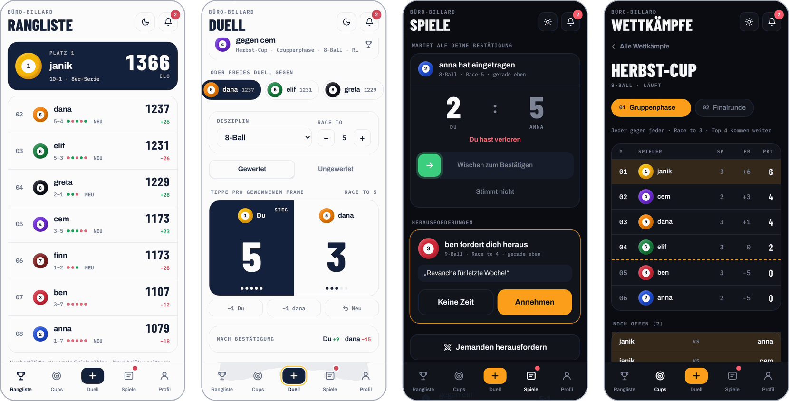
</p>

The interface is in German, with a light and a dark theme that follow the system setting.

## Features

- **Sign-up by QR code.** The code contains an invite key. Accounts need only a username and a password, no e-mail.
- **Duels with confirmation.** Tap once per won frame, send the result, and it counts only after the opponent confirms it with a swipe.
- **Rated or casual.** Casual games show up in the history but never change Elo.
- **Elo ranking.** Form of the last games, rating history, peak rating and head-to-head for every player.
- **Competitions with stages.** For example a round robin group stage followed by a knockout final. The best players of each stage move on.
- **Challenges.** Challenge someone with discipline, race length and a short message.
- **Installable app with push.** Add it to the home screen and get notified about challenges, results to confirm and new competition stages.
- **Fixed admins.** Admin rights come from the server configuration, not from the app.
- **Mobile first.** Built for phones, works in any modern browser. Light and dark theme.

## Screenshots

<table>
  <tr>
    <td align="center">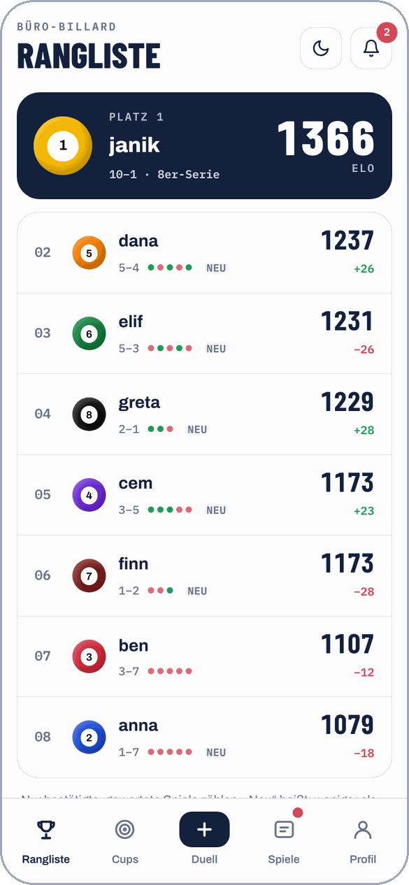<br><sub>Ranking</sub></td>
    <td align="center">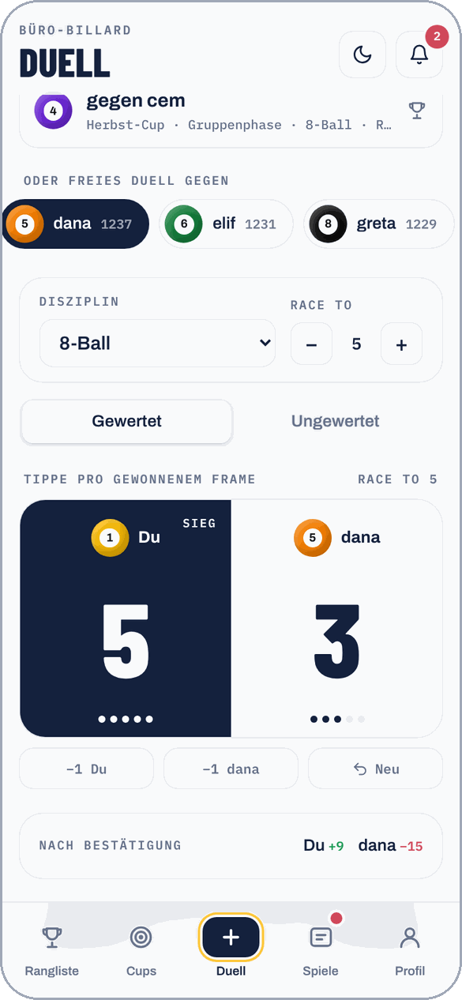<br><sub>Duel: one tap per frame</sub></td>
    <td align="center">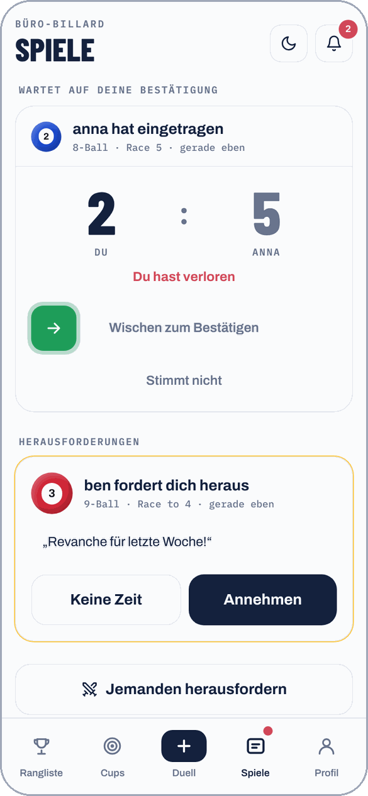<br><sub>Swipe to confirm</sub></td>
  </tr>
  <tr>
    <td align="center">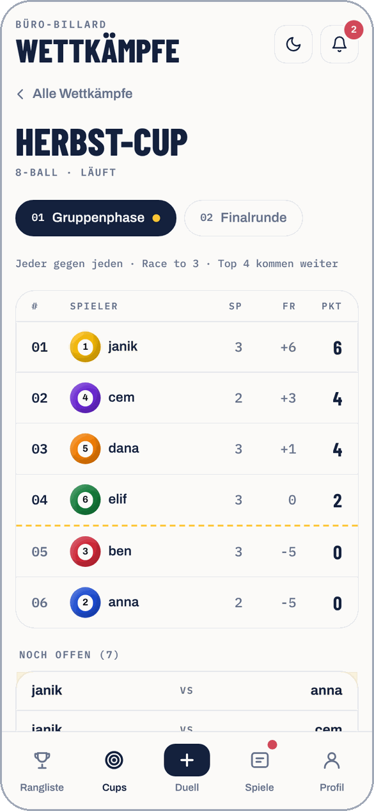<br><sub>Competition stage</sub></td>
    <td align="center">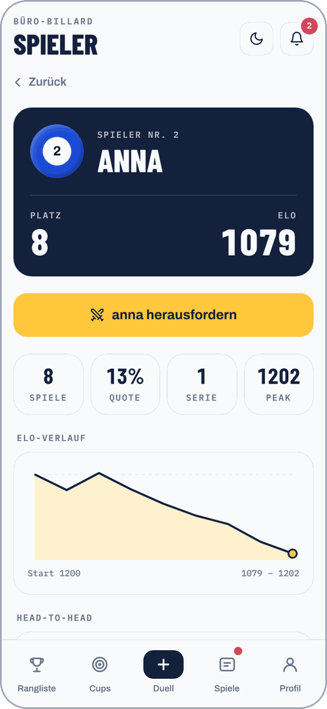<br><sub>Player profile</sub></td>
    <td align="center">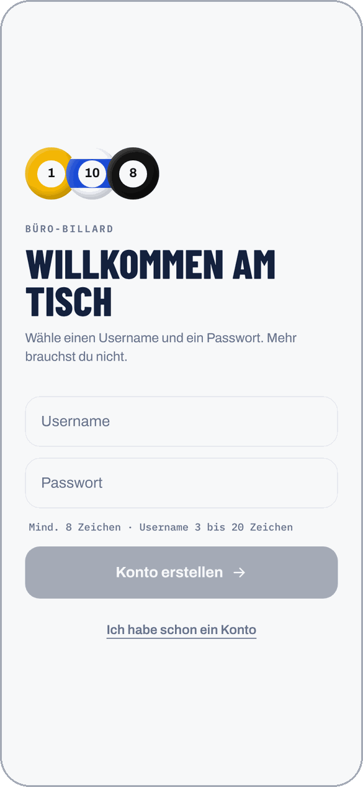<br><sub>Sign-up via QR code</sub></td>
  </tr>
</table>

<details>
<summary><b>Dark theme</b></summary>
<br>
<table>
  <tr>
    <td align="center">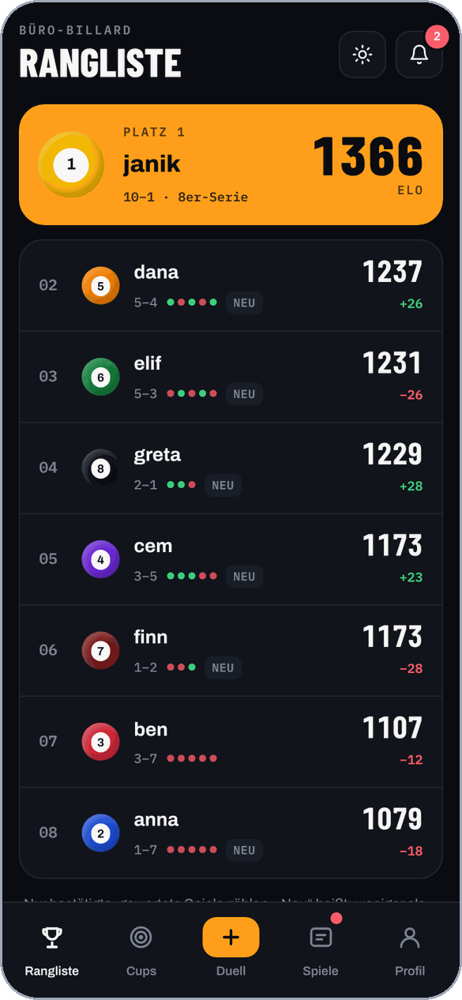<br><sub>Ranking</sub></td>
    <td align="center">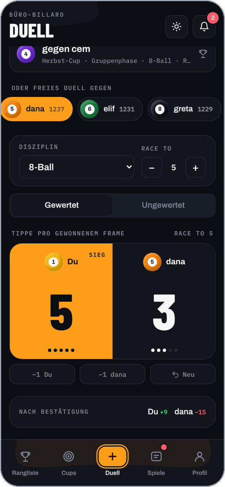<br><sub>Duel</sub></td>
    <td align="center">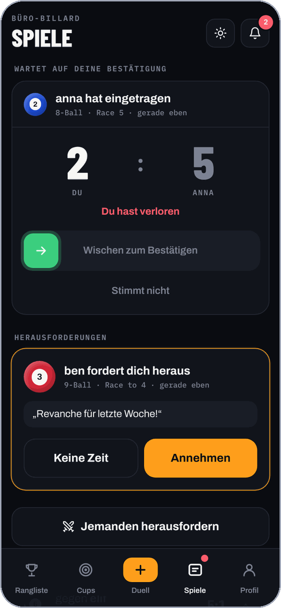<br><sub>Swipe to confirm</sub></td>
  </tr>
  <tr>
    <td align="center">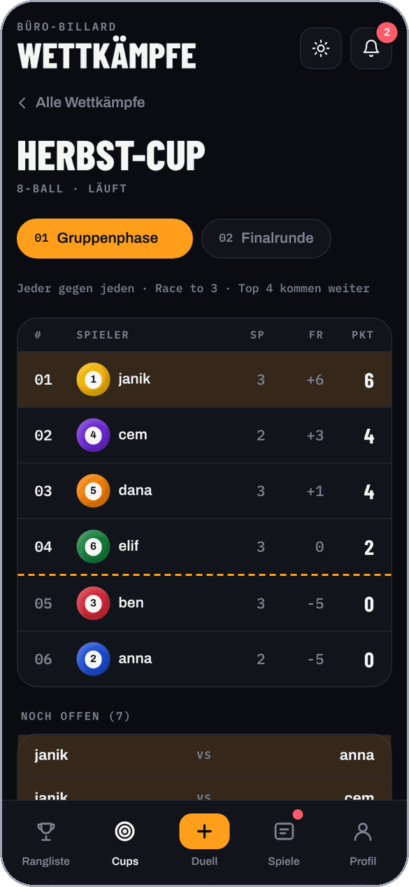<br><sub>Competition stage</sub></td>
    <td align="center">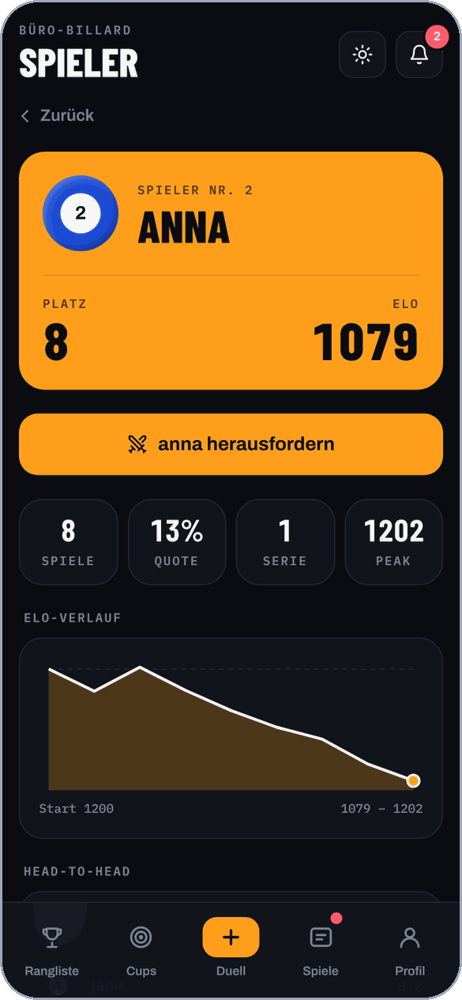<br><sub>Player profile</sub></td>
    <td align="center">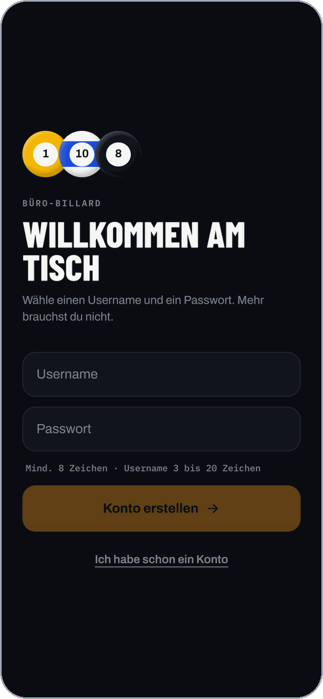<br><sub>Sign-up</sub></td>
  </tr>
</table>
</details>

## How it works

1. **Set up.** An admin prints the QR code from the profile page and hangs it next to the table.
2. **Join.** New players scan it, choose a username and password and are in.
3. **Play.** After a game one player opens *Duell*, picks the opponent and taps once per won frame.
4. **Confirm.** The opponent gets a push message and swipes to confirm, or taps *Stimmt nicht*.
5. **Rank.** Confirmed, rated games update the Elo ranking immediately. Competition tables and brackets fill themselves.

## Quick start with Docker

```bash
cp .env.example .env   # set INVITE_KEY, ADMIN_USER_IDS and PUBLIC_URL
docker compose up -d
```

Open the app, create the first account with `https://<your-host>/join?key=<INVITE_KEY>`. The first account gets user number 1, so with `ADMIN_USER_IDS=1` it is the admin. Admins find the QR code to print under **Profil**.

All data lives in one SQLite file in `./data`. Back up that folder.

## Configuration

| Variable | Meaning | Default |
| --- | --- | --- |
| `INVITE_KEY` | Secret in the QR code that allows sign-ups. Required. | |
| `ADMIN_USER_IDS` | Comma-separated user numbers with admin rights | none |
| `APP_NAME` | Name shown in the app and on the QR code | `Billard` |
| `PUBLIC_URL` | Public address for the invite link | request origin |
| `COOKIE_SECURE` | `true` when served over HTTPS | `false` |
| `PORT` | HTTP port | `3000` |
| `DATABASE_PATH` | SQLite file | `./data/billard.sqlite` |
| `VAPID_PUBLIC_KEY`, `VAPID_PRIVATE_KEY` | Keys for push messages | generated once, stored in the database |
| `VAPID_SUBJECT` | Contact for push services (`mailto:` or `https:`) | `PUBLIC_URL` if https |

To revoke the QR code, change `INVITE_KEY` and restart. Existing accounts keep working.

## Push notifications

Push needs HTTPS (or `localhost` during development). Players switch it on under **Profil**. On iPhone and iPad (iOS 16.4 or newer) push only works after adding the app to the home screen via Safari's share menu; the app explains this to the user.

Players get a push when someone challenges them, answers their challenge, enters a result they need to confirm, confirms or rejects their result, or when they reach a new competition stage.

## Development

Requires Node.js 22.18 or newer (the server runs TypeScript directly and uses the built-in SQLite module).

```bash
npm install
cp .env.example .env              # set INVITE_KEY=dev, COOKIE_SECURE=false
npm run seed                      # optional: demo players, password "billard123"
npm run dev:server                # API on :3000
npm run dev                       # frontend on :5173, proxies /api
```

Log in with `janik` / `billard123` after seeding to see the screens above with demo data.

| Command | Purpose |
| --- | --- |
| `npm test` | Unit and API tests (Vitest) |
| `npm run lint` | Lint (oxlint) |
| `npm run build` | Type check and build the frontend into `dist/` |
| `npm start` | Serve API and built frontend |

## How Elo works

Everyone starts at 1200. After each confirmed, rated duel:

```
expected = 1 / (1 + 10^((opponent - own) / 400))
new      = own + K × M × (result − expected)
```

- `K` is 40 for a player's first 10 rated games, then 24.
- `M = 1 + 0.5 × frame difference / race-to`, so a 5:0 counts more than a 5:4.

Ratings are always recalculated from the full match list, so deleting or late-confirming a game keeps every number consistent.

## Project layout

```
server/      API (Hono), SQLite schema, auth
src/lib/     shared logic: Elo, ratings, competitions (used by server and app)
src/         React app (Tailwind CSS, light and dark theme tokens in src/index.css)
public/      service worker and app icons
scripts/     demo data
docs/        screenshots for this README
```
